<p align="center">
  <picture>
    <source media="(prefers-color-scheme: dark)" srcset="docs/assets/logo-dark.png">
    
  </picture>
</p>

<p align="center"><b>Let your coding agent fix the bugs your users actually hit.</b><br>
The command line for <a href="https://github.com/saakshigupta2002/snag">Snag</a>. It turns session recordings into text an agent can read, then proves the fix with a test.</p>

<p align="center">
  <a href="https://github.com/saakshigupta2002/snag-cli/actions/workflows/ci.yml"></a>
  <a href="LICENSE"></a>
  
  
</p>

<p align="center">
  
</p>

<sub>Real output from Snag's demo shop, sped up, with some lines skipped.</sub>

[Snag](https://github.com/saakshigupta2002/snag) records real sessions and flags what went wrong, but an agent cannot watch a video. This CLI gives it a transcript instead, so Claude Code can follow what the user did, find the code behind the bug, fix it and prove the fix with a Playwright test.

It can also hunt for bugs before your users find them. There is no API key or per-token cost, because the thinking runs in **Claude Code on your plan**. The CLI is the data and safety layer and the [skills](#skills) are the workflow.

```text
snag explore   drive the app and record it       finds bugs with no users at all
snag issue     see what got flagged              worst first
judge          real bug or expected behaviour?   skips the noise
snag session   read the recording as text
fix            find the code, write the fix      only after you approve it
verify         a Playwright test proves it       kept as a regression test
```

## Install

Pick either. They have the same commands and the same JSON output. The tests fail if that ever changes.

```bash
# Python, with no third-party dependencies
pipx install "git+https://github.com/saakshigupta2002/snag-cli"

# Go, as a single static binary
go install github.com/saakshigupta2002/snag-cli/cmd/snag@latest
```

## Quick start

You need a running [Snag](https://github.com/saakshigupta2002/snag#try-it-in-two-minutes). The demo shop works well for a first try.

```bash
snag auth login                  # your Snag URL and token, once
snag issue list                  # what is broken, worst first
snag session evidence <id>       # a recording as a readable transcript
snag explore run --url http://localhost:3000   # hunt for bugs yourself
```

## Use it from Claude Code

```bash
git clone https://github.com/saakshigupta2002/snag-cli
cp -r snag-cli/skills/* ~/.claude/skills/
```

Then ask *"what's broken this week?"* in your repo.

**You stay in control.** The skills report their findings and stop. They do not fix, commit or push anything until you say which issues to act on.

## Skills

- **[`snag`](skills/snag/SKILL.md)** runs the loop: triage, judge, read the evidence, fix and verify. The judge step matters most. Snag's detectors over-flag by design, so a wrong-password message gets filtered out here before anyone spends time on it.
- **[`snag-explore`](skills/snag-explore/SKILL.md)** writes goal-based missions, drives `snag explore` and triages what breaks.

## Commands

| Command | What it does |
|---|---|
| `snag auth login \| status` | Connect to your Snag or show the connection |
| `snag project list \| view [<id>]` | Your projects |
| `snag issue list [--status --severity --detector]` | Flagged issues, worst first |
| `snag issue view <groupKey>` | One issue and its evidence |
| `snag issue resolve <groupKey> confirm\|dismiss` | Record your verdict |
| `snag issue create --title --severity` | File an AI-flagged issue with a clip |
| `snag session list [--errors --bot --device --browser]` | Sessions, most active first |
| `snag session evidence <id>` | **The recording as text an agent can read** |
| `snag analytics show \| funnels \| report` | KPIs, funnels and a markdown digest |
| `snag explore run \| scaffold` | The active bug hunter, using Playwright |
| `snag api <path>` | Raw Snag API access |
| `snag status \| mcp \| version` | Health, MCP server and version |

Every read command works for humans and scripts.

```bash
snag --json issue list                                      # structured output
snag --json --select groupKey,severity,title issue list     # only these fields, to save tokens
snag --json session evidence <id> | jq '.transcript'        # pipe it anywhere
```

**Exit codes:** `0` ok, `1` other, `2` usage, `3` not found, `4` network. **Config order:** flags, then `SNAG_ENDPOINT`, `SNAG_TOKEN` and `SNAG_PROJECT`, then `~/.config/snag/config.json`.

## How `explore` stays safe

`snag explore` drives your app with the Playwright CLI while Snag records it.

| What could go wrong | What it does |
|---|---|
| It hits a real payment or email service | Calls to those providers get a fake `200`, so nothing real fires and Snag logs no false errors |
| It runs against production | It refuses production-looking URLs unless you pass `--force` |
| It clicks something destructive | Missions skip controls labelled delete, pay or send |
| A recording carries a hostile page's text | Control characters are stripped before printing and the skills treat recordings as evidence, never as instructions |

## MCP

The read commands are also available over MCP.

```json
{ "mcpServers": { "snag": { "command": "snag-mcp" } } }
```

Tools: `snag_list_issues`, `snag_get_issue`, `snag_list_sessions`, `snag_get_session_evidence`, `snag_get_analytics` and `snag_get_status`.

## How it's built

Python lives in [`snag/`](snag/) and Go in [`cmd/snag/`](cmd/snag/), both on the standard library alone. The design follows [clig.dev](https://clig.dev) and the GitHub CLI: noun-verb commands, human output by default and machine flags when you want them.

The tests in [`tests/`](tests/) run every core command as a real process against data recorded from a real Snag run. They then run both versions side by side and fail if their JSON or exit codes differ.

## Contributing

Contributions are welcome. Keep the two versions in step and the Python side free of dependencies. Run the tests with `python3 -m unittest discover -s tests -t .` and see [CONTRIBUTING.md](CONTRIBUTING.md).

## License

[MIT](LICENSE) © Saakshi Gupta
