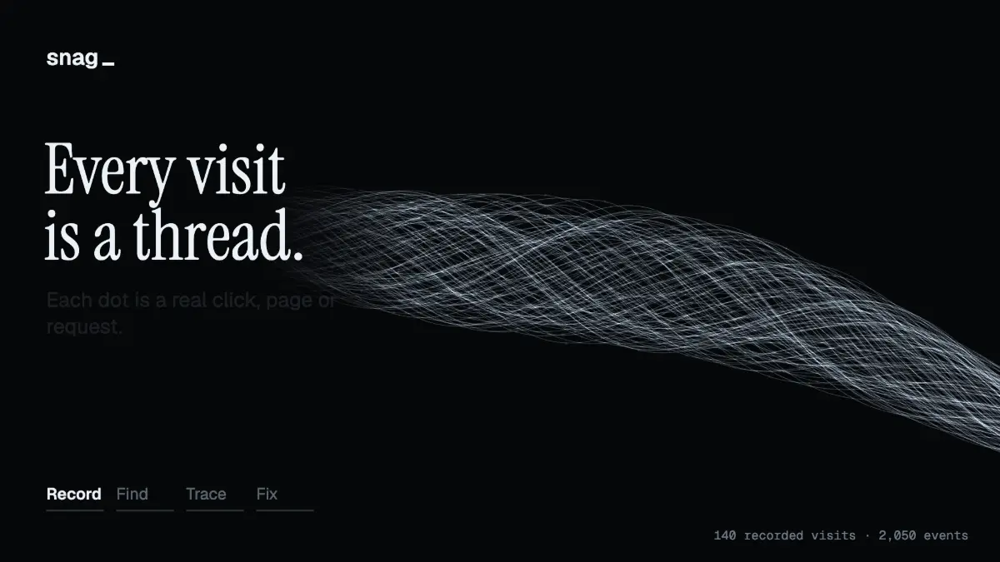
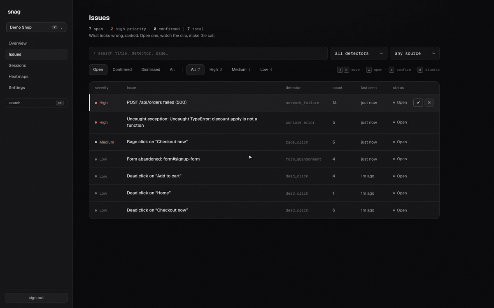
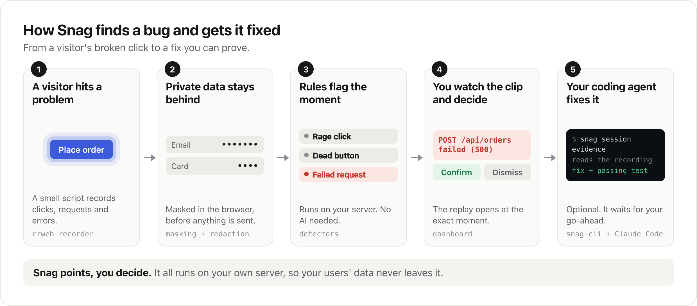
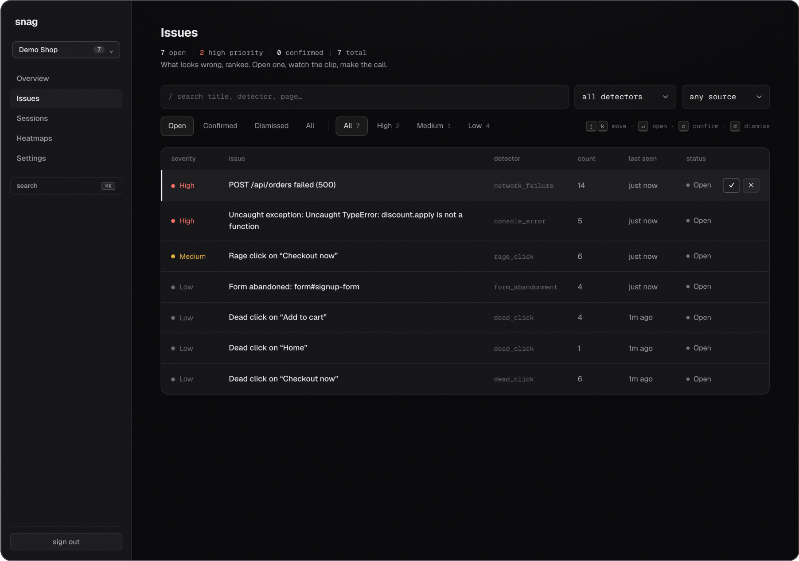
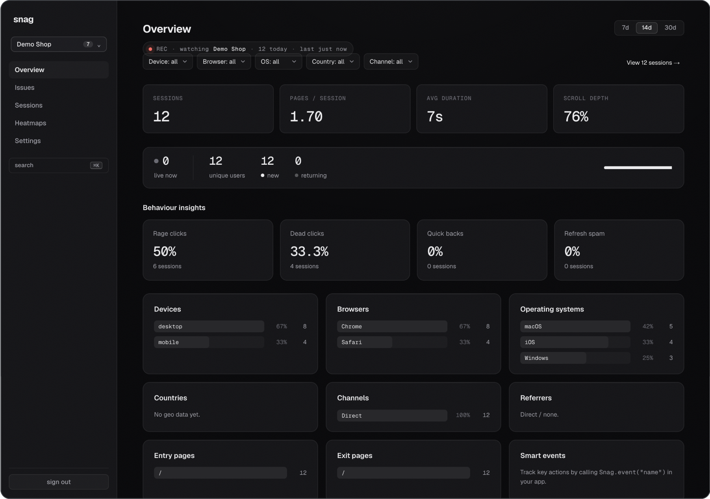

<p align="center">
  <picture>
    <source media="(prefers-color-scheme: dark)" srcset="docs/assets/logo-dark.png">
    
  </picture>
</p>

<p align="center"><b>See the bugs your users hit. Let your coding agent fix them.</b><br>
Self-hosted session replay that finds what broke, then hands it to Claude Code or Codex as a trace it can read.</p>

<p align="center">
  <a href="https://github.com/saakshigupta2002/snag/actions/workflows/ci.yml"></a>
  <a href="LICENSE"></a>
  
  
</p>

<p align="center">
  <a href="docs/assets/snag-hero.mp4"></a>
</p>

<p align="center"><sub>Every thread is a real visit recorded by Snag on the bundled demo shop. <a href="docs/assets/snag-hero.mp4">Watch the full-quality video</a>.</sub></p>

A customer clicks **Place order**. The request returns a 500, nothing happens on screen and they leave. They do not file a bug report. Your logs show a number. They cannot show you what the person was trying to do.

Session replay can show you, but someone still has to watch hours of recordings to find the problem and those recordings usually live on a vendor's servers.

**Snag watches for you.**

- **It finds the problem.** Plain rules catch rage clicks, dead buttons, crashes, failed requests and abandoned forms. No AI and no model bill.
- **It shows you the cause.** Every issue opens the replay at the flagged second, with the failed request or stack trace beside the click.
- **It stays yours.** It runs on your own server. Passwords, card numbers and tokens are masked in the browser before anything is sent.
- **Your agent finishes the job.** The [Snag CLI](#fix-bugs-with-your-coding-agent) gives a recording to Claude Code or Codex as text, so it can find the code, write the fix and prove it with a test. It stops for your go-ahead first.

## Try it in two minutes

You need Node 20 or newer. There is no database, account or key to set up.

```bash
git clone https://github.com/saakshigupta2002/snag && cd snag
npm ci && npm run build:libs

npm run dev:ingest      # terminal 1: the API, running in memory
npm run dev:dashboard   # terminal 2: the dashboard on http://localhost:3000
npm run demo            # terminal 3: a demo shop that is broken on purpose
```

Create a project at [localhost:3000](http://localhost:3000) and copy its key. Open `http://localhost:5173/?key=<your key>`, click around like a confused customer and close the tab. Your issues appear in the dashboard within seconds.

## See it in action

<p align="center">
  <a href="docs/assets/snag-walkthrough.mp4"></a>
</p>

<p align="center"><sub>23 seconds of the real dashboard on the bundled demo shop. <a href="docs/assets/snag-walkthrough.mp4">Open the 1080p video</a>.</sub></p>

## Add it to your app

Your ingest service serves the recorder, so there is nothing to install. It works on any website.

```html
<script src="https://your-ingest-host/snag.js"></script>
<script>
  Snag.init({ projectKey: "pk_live_xxx", endpoint: "https://your-ingest-host" });
</script>
```

Settings in the dashboard shows this snippet with your key filled in. The recorder is 63 KB gzipped and it records page structure rather than video, so a 7 second session from the demo shop is 17 KB.

To run the full stack with Postgres:

```bash
cp .env.example .env
docker compose up --build    # http://localhost:3000, password "snag" until you set your own
```

Every port stays on your machine until you choose otherwise. [docs/self-hosting.md](docs/self-hosting.md) covers going live on a VM, Railway, Render or Fly and [Vercel with Supabase](docs/deploy-vercel-supabase.md).

## How it works

<p align="center">
  <picture>
    <source media="(prefers-color-scheme: dark)" srcset="docs/assets/how-it-works-dark.png">
    
  </picture>
</p>

## What it catches

Snag caught all five bugs planted in the demo shop, across 12 scripted visits and with no configuration.

| It noticed | What Snag showed | Severity |
|---|---|---|
| A request failed | `POST /api/orders failed (500)`, 14 times in 7 sessions | High |
| The page crashed | `TypeError: discount.apply is not a function`, with the stack trace | High |
| Someone hammered a button | `Rage click on "Checkout now"`, 6 times | Medium |
| A form was left unfinished | `Form abandoned: form#signup-form`, 4 times | Low |
| A button did nothing | `Dead click on "Add to cart"`, 4 times | Low |

You can tune every threshold for each project and add your own flags from simple dropdowns. Four noisier detectors stay off until you have tuned them for your traffic. See [the detector reference](docs/detectors.md) and [custom flags](docs/custom-flags.md).

## Fix bugs with your coding agent

An agent cannot watch a video but it can read a transcript. The Snag CLI in [`cli/`](cli/) turns a recording into one, so your coding agent can follow what happened and find the code behind it.

<p align="center">
  
</p>

<sub>Real output from the demo shop, sped up, with some lines skipped.</sub>

```bash
pipx install "git+https://github.com/saakshigupta2002/snag#subdirectory=cli"
snag setup        # connects Claude Code and Codex: installs the skills, registers the MCP server
snag auth login   # your Snag address and token, once
```

Then ask your agent *"what's broken this week?"* in your repo.

| Your agent | What `snag setup` does |
|---|---|
| **Claude Code** | Installs the skills in `~/.claude/skills` and adds the `snag` MCP server |
| **Codex** (beta) | Installs the skills in `~/.agents/skills` and adds the `snag` MCP server |
| **Any MCP client** | Point it at `snag mcp`. It serves issues, sessions and the evidence transcript |

The agent separates real bugs from expected behaviour, then reports back. Nothing changes until you say which ones to fix. The thinking runs on your agent's plan, so there is no API key and no per-token bill. The CLI also ships as a single Go binary: `go install github.com/saakshigupta2002/snag/cli/cmd/snag@latest`. Every command is in the [CLI guide](cli/README.md).

## Everything else in the dashboard

<table>
  <tr>
    <td width="50%"></td>
    <td width="50%"></td>
  </tr>
  <tr>
    <td align="center"><sub>Triage from the keyboard</sub></td>
    <td align="center"><sub>Analytics where every number opens the sessions behind it</sub></td>
  </tr>
</table>

- **Sessions worth watching**, ranked by activity so idle visits stay out of your way
- **Click heatmaps** and **funnels** with replays of the people who dropped off
- **Copy bug report** for a ready-made GitHub issue with steps to reproduce
- **Webhook alerts** that work with Slack when a new issue crosses your severity level
- **A read-only demo link** for one project, with no login

## Built to be trusted

| What could go wrong | What Snag does |
|---|---|
| A password gets recorded | Password fields are always masked and every other input records as dots by default |
| A card number or token sits in page text | A safety net masks emails, Luhn-checked card numbers, JWTs and long tokens even when nothing is tagged |
| Secrets travel in network calls | `Authorization` and cookies are always dropped. Other values go through a key denylist and a shape check |
| The tool cries wolf | Every detector has positive and negative fixtures and new ones ship switched off |
| The recorder breaks your site | It fails quietly and stays out of your app's way |
| Data leaves your server | Nothing phones home. The optional AI layer uses your own key, only sees flagged moments and has a daily cap |

All of this runs in the browser, before anything is sent. Pattern matching is never perfect, which is why the layers stack and the default is to redact. See [docs/configuration.md](docs/configuration.md) and [SECURITY.md](SECURITY.md).

## Good to know

- **One login.** Each deployment has a single password. There are no teams or roles yet.
- **Script tag only.** The recorder is not on npm yet, so load it from your ingest service.
- **After the fact.** Detection runs when a session ends, so issues appear after the visitor leaves and not during their visit.
- **Heatmaps mix screen sizes.** Phone and desktop clicks share one view for now.
- **It does not fix bugs on its own.** Snag points and you decide. The agent loop is opt-in and waits for your approval.

## FAQ

**What does it cost?**
Snag is free and MIT licensed. You pay for wherever you host it. The smallest managed Postgres tiers are enough for a small app.

**Does it work with my framework?**
Yes. It is a script tag, so it works with React, Next.js, Vue, Svelte or plain HTML, including single-page navigation.

**How is it different from hosted session replay?**
You run it yourself, so your users' data stays with you. It also finds the problems for you and shows them as a ranked list of issues, instead of leaving you with a pile of recordings.

**Is the AI required?**
No. All detection is plain code. The AI layer is off by default and needs your own Anthropic or OpenAI key.

## Project layout

```
packages/sdk         the recorder: rrweb, masking, redaction and transport
packages/detectors   the detection engine and each detector
packages/ingest      the API and workers, on Fastify and Postgres
packages/dashboard   the web app, on Next.js
packages/shared      shared TypeScript types
cli                  the CLI, MCP server and agent skills, in Python and Go
examples/demo-app    the demo shop that is broken on purpose
```

## Contributing

Contributions are welcome, especially new detectors and framework guides. `npm run check` runs the types, tests and style checks. Start with [CONTRIBUTING.md](CONTRIBUTING.md) or a [good first issue](https://github.com/saakshigupta2002/snag/labels/good%20first%20issue).

## License

[MIT](LICENSE) © Saakshi Gupta
